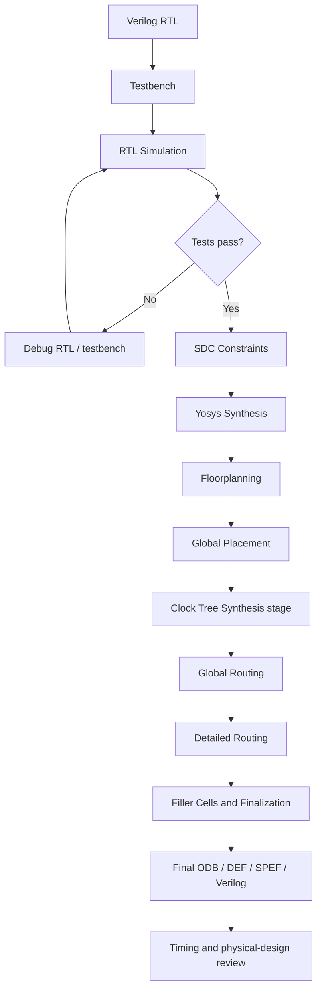

# 16-Bit ALU Design and Physical Implementation Using OpenROAD

A 16-bit combinational Arithmetic Logic Unit (ALU) implemented in Verilog, functionally verified with Icarus Verilog, and taken through an RTL-to-physical-design flow using Yosys and OpenROAD with the Nangate45 standard-cell library.

## Project overview

The ALU accepts two 16-bit operands (`a`, `b`) and a 4-bit opcode. It produces a 16-bit result and status flags (`zero`, `carry`, and `overflow`).

### Supported operations

| Opcode | Operation | Description |
|---|---|---|
| `0000` | ADD | A + B |
| `0001` | SUB | A − B |
| `0010` | AND | Bitwise AND |
| `0011` | OR | Bitwise OR |
| `0100` | XOR | Bitwise XOR |
| `0101` | NOR | Bitwise NOR |
| `0110` | SLL | Logical left shift |
| `0111` | SRL | Logical right shift |
| `1000` | SRA | Arithmetic right shift |
| `1001` | SLT | Unsigned less-than comparison |
| `1010` | EQ | Equality comparison |
| `1011` | NAND | Bitwise NAND |
| `1100` | XNOR | Bitwise XNOR |
| `1101` | PASS A | Output operand A |
| `1110` | PASS B | Output operand B |
| `1111` | ZERO | Output zero |

The exact status-flag behavior for non-arithmetic operations is determined by the RTL implementation.

## Tools

- Verilog HDL — RTL design
- Icarus Verilog — simulation
- Yosys — logic synthesis
- OpenROAD — physical implementation
- Nangate45 — standard-cell library/platform
- SDC — timing constraints
- Git/GitHub — version control

## Design flow

GitHub renders this Mermaid flowchart directly:



### Flow stages

1. **RTL design and simulation:** Develop the ALU and verify its functional behavior using the testbench.
2. **SDC constraints:** Define the reference clock and external input/output timing assumptions.
3. **Synthesis:** Map the RTL into standard cells using Yosys.
4. **Floorplanning:** Establish the core layout and power-distribution structures.
5. **Placement:** Place standard cells and optimize their locations.
6. **Clock-tree synthesis stage:** The flow runs this stage, although the ALU is combinational and has no intentional sequential datapath registers.
7. **Routing:** Perform global and detailed routing.
8. **Finalization:** Insert filler cells and generate the final physical-design database and related outputs.
9. **Review:** Inspect timing reports and physical-design results.

## SDC timing constraints

The project constraint file (`constraint.sdc`) contains:

```tcl
create_clock -name virtual_clock -period 10

set_input_delay 0.5 -clock virtual_clock [all_inputs]

set_output_delay 0.5 -clock virtual_clock [all_outputs]
```

### `create_clock`

```tcl
create_clock -name virtual_clock -period 10
```

Creates a **virtual reference clock with a 10 ns period** (equivalent to a 100 MHz reference frequency). A virtual clock does not correspond to a physical clock input port; it provides a timing reference for external input and output delays.

### `set_input_delay`

```tcl
set_input_delay 0.5 -clock virtual_clock [all_inputs]
```

Models an assumed 0.5 ns delay outside the design before input signals reach the ALU. This helps represent the external timing budget.

### `set_output_delay`

```tcl
set_output_delay 0.5 -clock virtual_clock [all_outputs]
```

Reserves an assumed 0.5 ns of the timing budget for downstream circuitry to receive the ALU outputs.

### Timing-analysis note

The input/output delay constraints describe the external timing assumptions. Verify that the intended SDC is loaded and that input-to-output paths are constrained before interpreting slack as proof of timing closure. This design is combinational, so its principal functional paths run from input ports through combinational logic to output ports.

## Run RTL simulation

From the repository root:

```bash
iverilog -g2012 -Wall -s tb_alu16 -o alu16_sim rtl/alu16.v tb/tb_alu16.v
vvp ./alu16_sim
```

The recorded local testbench run passed 17 test cases. Simulation verifies function; it does not prove physical timing closure or manufacturing signoff.

## OpenROAD outputs

The generated files were located under:

```text
results/nangate45/alu16/base/
```

| File | Description |
|---|---|
| `6_final.odb` | Final OpenROAD physical-design database |
| `6_final.def` | Final physical design representation |
| `6_final.spef` | Extracted parasitic resistance/capacitance data |
| `6_final.v` | Final mapped Verilog netlist |
| `6_final.sdc` | Saved timing constraints |
| `6_finish.rpt` | Final timing/implementation report |
| `5_route_drc.rpt` | Routing DRC report generated by the flow |
| `synth_stat.txt` | Synthesis statistics |
| `congestion.rpt` | Routing congestion information |

### Open the final database in OpenROAD GUI

From the OpenROAD Flow Scripts `flow` directory:

```bash
openroad -gui
```

Then in the OpenROAD Tcl console:

```tcl
read_db results/nangate45/alu16/base/6_final.odb
read_sdc results/nangate45/alu16/base/6_final.sdc
```

## Timing analysis

A maximum-delay report can be requested in the OpenROAD Tcl console:

```tcl
report_checks -path_delay max -format full_clock_expanded
```

A reported path in this project showed 8.01 ns positive slack, but other report output indicated an unconstrained path. Therefore, treat that value as a path-specific observation, not proof of complete timing closure. Verify clock/SDC loading, constrained input-to-output paths, WNS/TNS, and routing DRC results before making signoff claims.

## Suggested repository structure

```text
alu16-openroad/
├── rtl/
│   └── alu16.v
├── tb/
│   └── tb_alu16.v
├── config/
│   ├── config.mk
│   └── constraint.sdc
├── reports/
│   ├── 6_finish.rpt
│   ├── 5_route_drc.rpt
│   └── synth_stat.txt
├── screenshots/
│   └── openroad-layout.png
└── README.md
```

This is a suggested organization. Include the reports and screenshot after copying them into the repository.

## Learning outcomes

- Combinational RTL design and testbench-based verification
- Logic synthesis and standard-cell mapping
- SDC timing constraint creation
- Floorplanning, placement, clock-tree synthesis, and routing
- Inspecting OpenROAD databases, timing reports, and physical-design outputs
- Git version control and technical documentation

## Future improvements

- Add randomized and boundary-value tests.
- Verify status-flag behavior for all opcodes.
- Resolve unconstrained timing paths and document fully constrained timing results.
- Review detailed-routing DRC results and physical verification.
- Generate and verify GDSII if supported by the installed toolchain.
- Compare area and timing across different constraint settings.

## Author

**Rudnesh Muthusamy**  
Electronics and Communication Engineering | VLSI and Digital Design  
GitHub: https://github.com/rudnesh
